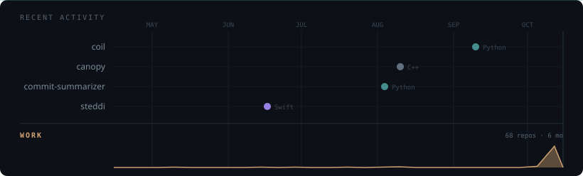

# nathan 👋

I build internal tools and native apps. The kind that connect systems no one designed to talk to each other, replace manual processes, and survive environments where "just use a SaaS" isn't an option.

**[ORCA](https://github.com/nathannncurtis/orca)** · An architectural pattern for building a fast, independent platform on a system you don't own and can't change.

**[Dokkit](https://dokkit.dev)** · One place that watches everything I run and tells me what needs my attention. Elixir, Phoenix, Go.

**[steddi](https://steddi.io)** · iOS navigation for people who already know their routes. Rerouted only when it actually matters. Swift, SwiftUI, MapKit.

**[coil](https://github.com/nathannncurtis/coil)** · Python-to-executable compiler. Directory in, `.exe` out. On [PyPI](https://pypi.org/project/coil-compiler/).

**[mdview](https://github.com/nathannncurtis/mdview-zig)** · Native markdown viewer in Zig. About 285 KB, no webview, no runtime.

The rest, including what I can't show, is at **[nathancurtis.me/work](https://nathancurtis.me/work)**.

---

### tech

languages 
       ![C#](https://img.shields.io/badge/C%23-239120?style=flat&logo=data%3Aimage%2Fsvg%2Bxml%3Bbase64%2CPHN2ZyBmaWxsPSJ3aGl0ZSIgcm9sZT0iaW1nIiB2aWV3Qm94PSIwIDAgMjQgMjQiIHhtbG5zPSJodHRwOi8vd3d3LnczLm9yZy8yMDAwL3N2ZyI%2BPHRpdGxlPkMjPC90aXRsZT48cGF0aCBkPSJNMS4xOTQgNy41NDN2OC45MTNjMCAxLjEwMy41ODggMi4xMjIgMS41NDQgMi42NzRsNy43MTggNC40NTZhMy4wODYgMy4wODYgMCAwIDAgMy4wODggMGw3LjcxOC00LjQ1NmEzLjA4NyAzLjA4NyAwIDAgMCAxLjU0NC0yLjY3NFY3LjU0M2EzLjA4NCAzLjA4NCAwIDAgMC0xLjU0NC0yLjY3M0wxMy41NDQuNDE0YTMuMDg2IDMuMDg2IDAgMCAwLTMuMDg4IDBMMi43MzggNC44N2EzLjA4NSAzLjA4NSAwIDAgMC0xLjU0NCAyLjY3M1ptNS40MDMgMi45MTR2My4wODdhLjc3Ljc3IDAgMCAwIC43NzIuNzcyLjc3My43NzMgMCAwIDAgLjc3Mi0uNzcyLjc3My43NzMgMCAwIDEgMS4zMTctLjU0Ni43NzUuNzc1IDAgMCAxIC4yMjYuNTQ2IDIuMzE0IDIuMzE0IDAgMSAxLTQuNjMxIDB2LTMuMDg3YzAtLjYxNS4yNDQtMS4yMDMuNjc5LTEuNjM3YTIuMzEyIDIuMzEyIDAgMCAxIDMuMjc0IDBjLjQzNC40MzQuNjc4IDEuMDIzLjY3OCAxLjYzN2EuNzY5Ljc2OSAwIDAgMS0uMjI2LjU0NS43NjcuNzY3IDAgMCAxLTEuMDkxIDAgLjc3Ljc3IDAgMCAxLS4yMjYtLjU0NS43Ny43NyAwIDAgMC0uNzcyLS43NzIuNzcxLjc3MSAwIDAgMC0uNzcyLjc3MlptMTIuMzUgMy4wODdhLjc3Ljc3IDAgMCAxLS43NzIuNzcyaC0uNzcydi43NzJhLjc3My43NzMgMCAwIDEtMS41NDQgMHYtLjc3MmgtMS41NDR2Ljc3MmEuNzczLjc3MyAwIDAgMS0xLjMxNy41NDYuNzc1Ljc3NSAwIDAgMS0uMjI2LS41NDZ2LS43NzJIMTJhLjc3MS43NzEgMCAxIDEgMC0xLjU0NGguNzcydi0xLjU0M0gxMmEuNzcuNzcgMCAxIDEgMC0xLjU0NGguNzcydi0uNzcyYS43NzMuNzczIDAgMCAxIDEuMzE3LS41NDYuNzc1Ljc3NSAwIDAgMSAuMjI2LjU0NnYuNzcyaDEuNTQ0di0uNzcyYS43NzMuNzczIDAgMCAxIDEuNTQ0IDB2Ljc3MmguNzcyYS43NzIuNzcyIDAgMCAxIDAgMS41NDRoLS43NzJ2MS41NDNoLjc3MmEuNzc2Ljc3NiAwIDAgMSAuNzcyLjc3MlptLTMuMDg4LTIuMzE1aC0xLjU0NHYxLjU0M2gxLjU0NHYtMS41NDNaIi8%2BPC9zdmc%2B)          

ai and ml 
            

models 
     

apps and frameworks 
              

infra and data 
            

documents and imaging 
   

---

<picture>
  <source media="(prefers-color-scheme: light)" srcset="assets/timeline-light.svg">
  
</picture>

---

the rest of me is at [nathancurtis.me](https://nathancurtis.me)
