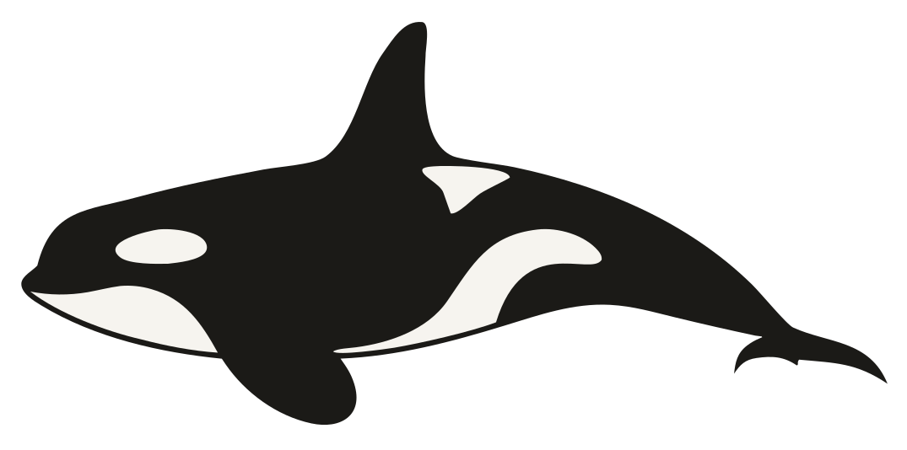
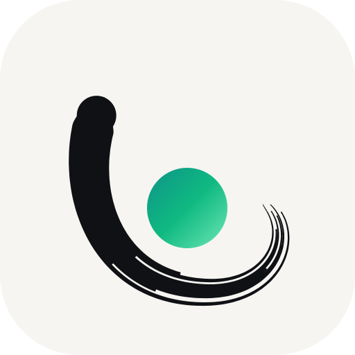

<picture><source media="(max-width: 600px) and (prefers-color-scheme: dark)" srcset="assets/hero-m-dark.svg"><source media="(max-width: 600px)" srcset="assets/hero-m-light.svg"><source media="(prefers-color-scheme: dark)" srcset="assets/hero-dark.svg"></picture>

<picture><source media="(max-width: 600px) and (prefers-color-scheme: dark)" srcset="assets/year-m-dark.svg"><source media="(max-width: 600px)" srcset="assets/year-m-light.svg"><source media="(prefers-color-scheme: dark)" srcset="assets/year-dark.svg"></picture>

<picture><source media="(prefers-color-scheme: dark)" srcset="assets/icon-orca-dark.svg"></picture>&nbsp; <a href="https://github.com/nathannncurtis/orca"><b>ORCA ↗</b></a> · An architectural pattern A fast, independent platform on top of a system you do not own and cannot change. <code>vendor db → capture → store → read models → apps</code> <a href="https://github.com/nathannncurtis/orca">source ↗</a> · <a href="https://orcapattern.org">paper ↗</a> · <a href="https://orcapattern.org/orca.pdf">pdf ↗</a> · <a href="https://doi.org/10.5281/zenodo.23493407">doi ↗</a>

<picture><source media="(prefers-color-scheme: dark)" srcset="assets/icon-dokkit-dark.svg"></picture>&nbsp; <a href="https://github.com/nathannncurtis/dokkit"><b>Dokkit ↗</b></a> · Monitoring One place that watches everything I run and tells me what needs my attention. <code>needs a look 5   down 1   nightly backup late, 40 min</code> <a href="https://github.com/nathannncurtis/dokkit">source ↗</a> · <a href="https://dokkit.dev">dokkit.dev ↗</a> · <a href="https://demo.dokkit.dev">live demo ↗</a>

<picture><source media="(prefers-color-scheme: dark)" srcset="assets/icon-magpie-dark.svg"></picture>&nbsp; <a href="https://github.com/nathannncurtis/magpie"><b>Magpie ↗</b></a> · iPhone browser The browser you shape. Free and open source; ads, trackers and cookie banners blocked, mods by anyone. <code>early work  ·  no account  ·  nothing collected</code> <a href="https://github.com/nathannncurtis/magpie">source ↗</a> · <a href="https://github.com/nathannncurtis/magpie/tree/main/docs/spec">design spec ↗</a>

<picture><source media="(prefers-color-scheme: dark)" srcset="assets/icon-coil-dark.svg"></picture>&nbsp; <a href="https://github.com/nathannncurtis/coil"><b>coil ↗</b></a> · Python compiler Directory in, executable out. No spec file, no hooks, no list of hidden imports. <code>$ coil build ./myproject  →  myproject.exe</code> <a href="https://github.com/nathannncurtis/coil">source ↗</a> · <a href="https://pypi.org/project/coil-compiler/">pypi ↗</a>

<picture><source media="(prefers-color-scheme: dark)" srcset="assets/icon-mdview-dark.svg"></picture>&nbsp; <a href="https://github.com/nathannncurtis/mdview-zig"><b>mdview ↗</b></a> · Markdown viewer A native markdown viewer, about 285 KB, with no webview and no runtime. <code>an Electron app  ~200 MB   mdview  285 KB</code> <a href="https://github.com/nathannncurtis/mdview-zig">source ↗</a> · <a href="https://github.com/nathannncurtis/mdview-zig/releases/latest">download ↗</a>

<picture><source media="(prefers-color-scheme: dark)" srcset="assets/icon-private-dark.svg"></picture>&nbsp; <b>Not public</b> · six projects Glyph-atlas compression, legal records production, precedent-driven judging, medical disc decryption, closed label formats, admin-free software delivery. <a href="https://nathancurtis.me/work">described in outline at nathancurtis.me/work ↗</a>

---

languages <picture><source media="(max-width: 600px) and (prefers-color-scheme: dark)" srcset="assets/stack-languages-m-dark.svg"><source media="(max-width: 600px)" srcset="assets/stack-languages-m-light.svg"><source media="(prefers-color-scheme: dark)" srcset="assets/stack-languages-dark.svg"></picture>

ai and ml <picture><source media="(max-width: 600px) and (prefers-color-scheme: dark)" srcset="assets/stack-ai-and-ml-m-dark.svg"><source media="(max-width: 600px)" srcset="assets/stack-ai-and-ml-m-light.svg"><source media="(prefers-color-scheme: dark)" srcset="assets/stack-ai-and-ml-dark.svg"></picture>

models <picture><source media="(max-width: 600px) and (prefers-color-scheme: dark)" srcset="assets/stack-models-m-dark.svg"><source media="(max-width: 600px)" srcset="assets/stack-models-m-light.svg"><source media="(prefers-color-scheme: dark)" srcset="assets/stack-models-dark.svg"></picture>

apps and frameworks <picture><source media="(max-width: 600px) and (prefers-color-scheme: dark)" srcset="assets/stack-apps-and-frameworks-m-dark.svg"><source media="(max-width: 600px)" srcset="assets/stack-apps-and-frameworks-m-light.svg"><source media="(prefers-color-scheme: dark)" srcset="assets/stack-apps-and-frameworks-dark.svg"></picture>

infra and data <picture><source media="(max-width: 600px) and (prefers-color-scheme: dark)" srcset="assets/stack-infra-and-data-m-dark.svg"><source media="(max-width: 600px)" srcset="assets/stack-infra-and-data-m-light.svg"><source media="(prefers-color-scheme: dark)" srcset="assets/stack-infra-and-data-dark.svg"></picture>

documents and imaging <picture><source media="(max-width: 600px) and (prefers-color-scheme: dark)" srcset="assets/stack-documents-and-imaging-m-dark.svg"><source media="(max-width: 600px)" srcset="assets/stack-documents-and-imaging-m-light.svg"><source media="(prefers-color-scheme: dark)" srcset="assets/stack-documents-and-imaging-dark.svg"></picture>

